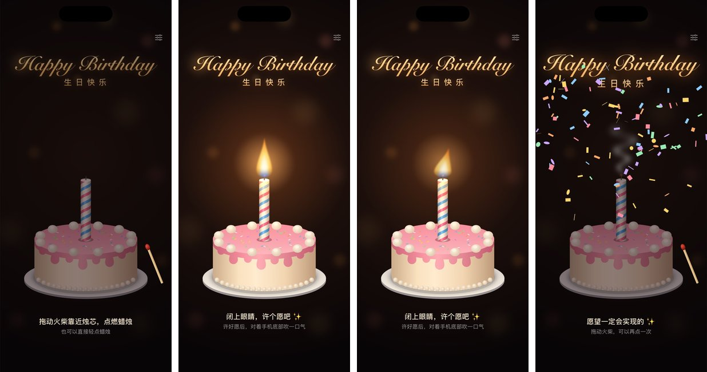

# 电子蜡烛 🕯️

一个生日用的 iOS 小应用。用火柴点燃蜡烛（也可以直接点一下），闭上眼睛许个愿，再对着手机吹一口气，蜡烛就灭了。灭了以后会冒一缕青烟、撒彩带，还会放一段八音盒版的《生日快乐》。



<sub>截图来自 iPhone 模拟器，从左到右依次是：还没点燃、燃烧中、正在吹气、吹灭了。</sub>

## 功能

- **生日蛋糕和蜡烛**：粉色奶油蛋糕上插着一根螺旋彩条的生日蜡烛。火焰一直在轻轻摇曳，周围有一圈暖光，把蜡烛和蛋糕照亮。你吹气的时候，火焰会被吹得东倒西歪。
- **手动点燃**：右下角有一根火柴，拿起来它就划着了，拖到烛芯上就能点燃蜡烛。也可以直接点一下蜡烛。
- **吹气熄灭**：用麦克风感应吹气，连续吹大约 0.25 秒蜡烛就会灭。灭掉后冒烟、撒彩带、放生日歌。手机开着静音时不会出声。
- **吹气力度条**：蜡烛燃烧时，屏幕下方有一条力度条，满了蜡烛就灭。
- **设置**：右上角可以调吹气灵敏度，也可以关掉生日歌。
- **隐私**：只有蜡烛燃烧时才会打开麦克风。声音只在手机上实时算一下音量，不录音、不保存、不联网。

## 运行要求

- 一台装了 Xcode 16 或更新版本的 Mac
- iOS 17 或更新版本的 iPhone。模拟器也能跑，会用 Mac 的麦克风。

## 装到 iPhone 上

1. 用 Xcode 打开 `DigitalCandle.xcodeproj`。
2. 在左侧点项目，选中 TARGETS 里的 **DigitalCandle**，进入 **Signing & Capabilities**。**Team** 选你自己的 Apple ID（没有就点 Add Account 登录，免费账号也行）。
   如果提示 Bundle Identifier 已被占用，把 `com.varusj.DigitalCandle` 改成别的名字，比如在后面加点字母。
3. 用数据线把 iPhone 连到 Mac，在 Xcode 顶部选中你的 iPhone，按 ⌘R 运行。
4. 第一次运行可能还要做两件事：
   - 在 iPhone 上打开「设置 → 隐私与安全性 → 开发者模式」，按提示重启手机。
   - 如果提示“不受信任的开发者”，到「设置 → 通用 → VPN 与设备管理」里信任你的开发者证书。
5. 打开 App，第一次点燃蜡烛时允许使用麦克风。

> 用免费 Apple ID 装的 App 7 天后会过期，到时候用 Xcode 再运行一次就好。

## 怎么玩

1. 把火柴拖到烛芯上点燃蜡烛，或者直接点一下蜡烛。
2. 闭上眼睛，许个愿 ✨
3. 对着手机**底部**吹一口气 🌬️ iPhone 的麦克风在那里。

吹了半天不灭，就在右上角设置里把灵敏度往右调。说说话、唱唱歌蜡烛就灭了，就往左调。

## 吹气是怎么检测的

吹气时，气流直接打在麦克风上，会产生又响又持续的“呼呼”风噪。说话、拍手、碰到手机的声音要么没那么响，要么很短。

- `MicrophoneLevelMonitor` 用 `AVAudioEngine` 读取麦克风。音频会话设成 measurement 模式，这个模式不做自动增益和人声处理，所以风噪不会被过滤掉。每一段音频只算出一个音量值（RMS，单位 dBFS）。
- `BlowAnalyzer` 把音量换算到 0 到 1。音量超过阈值并且持续约 0.25 秒，就算吹气。它还会一直估计环境底噪，环境越吵，阈值就越高，所以热闹的派对上蜡烛不会自己灭。
- 力度条和火焰晃动的幅度，都是按“当前音量离阈值还差多少”来算的。

## 代码结构

```
DigitalCandle/
├── DigitalCandleApp.swift            应用入口
├── ContentView.swift                 主界面：布局、拖火柴、提示文字
├── CandleModel.swift                 状态：未点燃 / 燃烧中 / 已吹灭，以及麦克风权限
├── SettingsView.swift                设置页：灵敏度、生日歌开关
├── Haptics.swift                     震动反馈
├── Audio/
│   ├── MicrophoneLevelMonitor.swift  读取麦克风音量
│   ├── BlowAnalyzer.swift            判断是不是在吹气
│   └── BirthdaySongPlayer.swift      用代码合成的八音盒生日歌
└── Views/
    ├── FlameView.swift               火焰和光晕动画
    ├── Candle.swift                  螺旋彩条的生日蜡烛、烛芯
    ├── Cake.swift                    生日蛋糕：奶油、淋面、彩色糖针、盘子
    ├── Effects.swift                 熄灭后的青烟和彩带
    ├── MatchStick.swift              火柴
    └── SceneDecor.swift              背景、标题、提示文字、力度条
```

## 自动构建

每次推送代码，`.github/workflows/ios.yml` 都会在 GitHub 的 macOS 机器上编译这个项目，并在 iPhone 模拟器里给各个状态截图（截图在这次运行的 Artifacts 里下载）。也可以在本地自己截：先编译出模拟器版本，再运行 `scripts/take-screenshots.sh <DigitalCandle.app 的路径> screenshots`。

私有仓库使用 macOS 机器，会按 10 倍消耗 GitHub Actions 的免费分钟数。不需要的话，删掉这个 workflow 文件就行。
